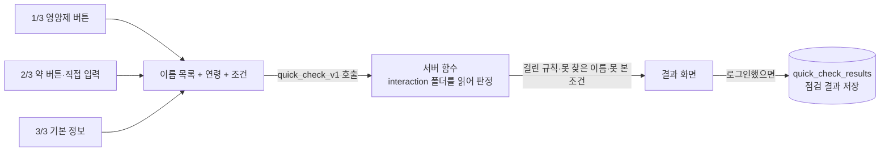
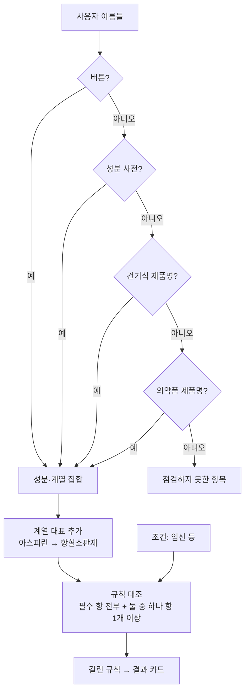

# 버튼을 누르면 데이터가 어디서 나오나 — 모두의 복약 데이터 흐름 설명서

> 대상: 약 × 영양제 조합 데이터를 채워 주시는 연구원·약사, 그리고 DB를 처음 보는 팀원.
> 코드·SQL 지식 없이 읽을 수 있게 썼습니다. 2026-10-13, 앱 v1.1.0(간편 로그인 포함) 기준.
>
> 함께 보면 좋은 것: `docs/erd-study-guide.md`(표 하나하나 설명), `docs/interaction-rule-intake-template.xlsx`(입력 양식).

---

## 0. 한눈에 보기

앱에는 사용자가 누르는 흐름이 크게 세 가지 있고, 각 흐름이 읽고 쓰는 데이터가 다릅니다.

| 사용자가 하는 일 | 읽는 데이터 | 쓰는 데이터 | 연구원 데이터와의 관계 |
|---|---|---|---|
| **1분 복용 점검** (영양제·약 버튼 → 결과) | `interaction` 폴더(조합 규칙·성분 사전·건기식) + 식약처 약 데이터 | 점검 결과 1건 (로그인한 경우) | **여기에 쓰입니다.** 적어 주신 한 줄이 결과 화면의 카드 한 장이 됩니다 |
| **복약 알람** (약 등록 → 알람 → "지금 약 먹기") | 내 일정 | 복약 기록, 알람 로그 | 관계 없음. 조합 데이터를 바꿔도 알람은 달라지지 않습니다 |
| **로그인·내 정보·삭제** | 내 계정·환자 행 | 동의 기록, 삭제(연쇄 삭제) | 관계 없음 |

DB는 폴더(스키마)가 둘입니다.

```
Supabase 프로젝트
├─ public       ← 사용자 데이터 (누가·언제·무슨 약·먹었나)  + 식약처 의약품·DUR 자료
└─ interaction  ← 약 지식 (어떤 조합이 왜 위험하고, 화면에 뭐라고 쓸 것인가)
                   앱은 이 폴더를 직접 열지 못하고, 서버 함수 quick_check_v1 을 통해 "답"만 받습니다
```

연구원이 채우는 데이터는 전부 `interaction` 폴더로 들어갑니다. 사용자 개인정보가 있는 `public`과는 섞이지 않습니다.

---

## 1. 1분 복용 점검 — 버튼에서 결과 카드까지

### 1.1 사용자가 보는 화면 세 장

| 화면 | 사용자가 하는 일 | 앱이 모아 두는 값 |
|---|---|---|
| 1/3 영양제 | 버튼(오메가3, 비타민D, 마그네슘, 유산균, 종합비타민, 철분, 루테인, 밀크씨슬 + 더 보기: 콜라겐, 아연, 홍삼, 단백질보충제) 또는 직접 입력 | 이름 목록 |
| 2/3 약 | 버튼(갑상선약, 혈압약, 고지혈증약, 위장약, 통증·소염제, 알레르기약, 피임약, 항우울제, 여드름약) 또는 직접 입력(성분명·제품명) | 이름 목록에 추가 |
| 3/3 기본 정보 | 연령대 하나(20대 … 60대 이상), 해당 항목(임신·수유 중 / 신장질환 / 간질환 / 해당 없음) | 연령, 조건 목록 |

"점검하기"를 누르면 앱은 이 세 가지를 서버 함수 `quick_check_v1(이름들, 연령, 조건들)`에 한 번에 보냅니다. **앱은 판정을 하지 않습니다.** 서버가 돌려준 것을 보여 주기만 합니다.



### 1.2 서버 안에서 벌어지는 일 — 네 단계

**① 이름을 성분으로 바꾼다.** 사용자가 보낸 이름 하나하나를 아래 순서로 찾아봅니다. 먼저 걸리는 곳에서 멈춥니다.

| 순서 | 어디서 찾나 (표 이름) | 예 | 결과 |
|---|---|---|---|
| 1 | 앱 버튼 표 `intake_class` → 버튼 풀이 표 `intake_class_resolution` | "혈압약" | 칼슘통로차단제·RAS차단제·칼륨보존이뇨제 **계열** 3개 |
| 2 | 성분 사전 `substance` (대표 이름 `name_ko` 또는 다른 표기 `aliases`) | "아스피린", "메트포르민염산염" | 성분 aspirin, metformin |
| 3 | 건기식 품목 `hff_product` 제품명 부분 일치 → 원료 `hff_product_ingredient` → 원료명→성분 `ingredient_substance_map` | "OO 홍국 캡슐" | 성분 홍국 |
| 4 | 의약품 품목 `dur_product_ingredient` 제품명 부분 일치 → 성분 영문 코드 | "리피토정" | 성분 atorvastatin |
| — | 네 곳 모두에서 못 찾음 | "꿀" | **"점검하지 못한 항목"** 으로 결과 화면 아래에 표시 |

> 여기서 연구원 데이터가 처음 쓰입니다. **성분 사전에 그 이름(또는 다른 표기)이 없으면 사용자가 아무리 정확히 적어도 "점검하지 못한 항목"이 됩니다.** 양식 ②「새 성분」의 "다른 표기" 칸이 이 단계를 위한 것입니다.

**② 계열을 붙인다.** 성분이 속한 계열(`substance_class_member`)을 따라가 "계열 대표" 성분도 집합에 넣습니다. 아스피린을 넣으면 항혈소판제·항혈전제·NSAID가 함께 들어갑니다. 그래서 연구원이 **"항혈소판제 × 오메가-3"** 처럼 계열로 적어도 사용자가 "아스피린"을 쳤을 때 걸립니다.

**③ 조건을 맞춘다.** 앱 버튼 이름과 DB 조건 이름(`condition.name_ko`)이 **글자 그대로** 같아야 합니다. 앱이 중간에서 바꿔 보내는 것은 아래가 전부입니다.

| 앱 버튼 | 서버로 가는 조건 이름 | 지금 상태 |
|---|---|---|
| 임신·수유 중 | 임신 | 걸림 (수유만 해당하는 분도 임신 규칙을 받음 — 알고 감수) |
| 신장질환 | (없음) | DB에는 "만성콩팥병(3~4기·중증)"·"혈액투석"만 있어 뜻이 달라 연결 안 함 → **"확인하지 못한 정보"** 로 표시 |
| 간질환 | (없음) | DB에 간질환 조건 규칙이 없음 → 같은 표시 |
| 20대 … 60대 이상 | 연령 그대로 | DB에 연령 조건 규칙이 없어 아무 규칙도 안 걸림 |

> 연구원이 "신장질환이면 ○○ 주의" 규칙을 적어 주시면, 개발자가 조건 이름을 맞춰 연결합니다. 조건 이름을 새로 만드는 것은 개발 쪽 일이라 양식에는 뜻만 적어 주시면 됩니다.

**④ 규칙과 대조한다.** `interaction_rule`(규칙 한 줄 = 조합 하나)마다 그 규칙의 **항**(`interaction_rule_side`, "누구와 누구")이 사용자 집합에 있는지 봅니다.

- 항은 성분 / 계열 / 앱 버튼 / 조건 중 무엇이든 될 수 있습니다.
- 항에는 역할이 있습니다. **object(필수) 항은 전부**, **precipitant·either(둘 중 하나) 항은 하나 이상** 있으면 걸립니다.
  예: "PPI × (마그네슘 또는 비타민 B12)" — PPI는 필수, 영양소 둘은 "둘 중 하나". 사용자가 PPI와 마그네슘만 골라도 걸립니다. 양식 ①의 B칸에 "마그네슘 / 비타민 B12"로 적으시면 이렇게 들어갑니다.
- **승인된 규칙만 봅니다.** `is_active = true`인 규칙만 읽고, `is_active`는 약사가 `review_status = 'approved'`로 승인해야만 켤 수 있게 DB가 막아 둡니다. 적어 주신 규칙은 넣는 즉시가 아니라 **승인 뒤에** 화면에 나갑니다.



### 1.3 결과 화면에 어떻게 보이나

걸린 규칙 하나가 카드 한 장입니다. 카드의 각 부분이 어느 칸에서 오는지:

| 화면 위치 | 어디서 오나 (DB 칸) | 양식 ①의 어느 열 |
|---|---|---|
| 제목 "A × B" | 사용자가 넣은 이름(걸린 항) | — (자동) |
| 꼬리표 | `severity`(등급)를 아래 표로 바꿈 | 등급 |
| 본문 1~2문단 | `what_happens_ko` 줄바꿈 `what_to_do_ko` — **그대로, 앱이 한 글자도 덧붙이지 않음** | 무슨 일이 / 어떻게 하면 |
| 둘 다 비었으면 | `summary_ko` | 요약 한 줄 |
| 근거 표시 | `evidence_level` → 화면 글자 | 근거 수준 |
| (시간 조정일 때) 간격 | `min_separation_hours` | 시간 간격 |
| 맨 위 "확인 필요 N건" | 걸린 카드 수 | — |

등급 → 꼬리표 → 묶음:

| 양식의 등급 | DB 값 | 화면 꼬리표 | 결과 화면의 묶음 |
|---|---|---|---|
| 금기 | contraindicated | 함께 복용 시 주의 | 우선 확인 필요 |
| 주의 | caution | 우선 확인 필요 | 우선 확인 필요 |
| 시간 조정 | timing | 복용 시간 확인 필요 | 복용 시간 조정 |
| 확인 권장 | monitor | 주의사항 | 주의사항 |
| 알아두기 | info | 주의사항 | 주의사항 |
| (관계 종류가 고갈·과다인 규칙) | relation_kind depletion / limit | 중복·과다 확인 | 중복·과다 확인 |

근거 수준 → 화면 글자: 확립 → **연구로 확인됨**, 이론적·제한적 → **가능성 있음**, 엇갈림 → **의견이 갈림**.

카드 아래에는 서버가 "못 본 것"을 숨기지 않고 보여 줍니다.

- **점검하지 못한 항목 N개** — 1.2 ①에서 네 곳 모두 못 찾은 이름.
- **이번 점검에서 아직 확인하지 못한 정보: 신장질환** — 조건 규칙이 없어 판정에 못 쓴 조건.
- **성분을 확인하지 못한 원료: ○○추출분말** — 제품은 찾았지만 원료명→성분 매핑이 없는 원료.

**식약처 병용금기(DUR)** 도 같은 화면에 섭니다. 사용자가 **의약품 제품명**을 넣었을 때만, 식약처 `dur_contraindication` 1,706건과 대조해 걸린 조합을 "함께 복용 시 주의" 꼬리표로 보여 줍니다. 본문은 식약처 고시 사유 그대로라 어르신 말투가 아닙니다(연구원에게 쉬운 말 번역을 요청할 수 있는 부분).

### 1.4 결과는 어디에 남나

로그인한 사용자가 결과를 보면 `public.quick_check_results`에 한 줄 저장됩니다. 고른 것(`items`)과 화면에 보인 카드(`findings`)를 그 모양 그대로 보관해 "그때 무엇이 보였나"를 남깁니다. 임신·신장질환 선택이 들어가므로 **건강 정보(민감정보)** 로 취급하고 따로 동의를 받습니다. 로그인 전 점검은 저장하지 않습니다.

---

## 2. 연구원 엑셀 한 줄이 DB에서 어떻게 나뉘나

양식 ①의 한 줄은 개발자가 아래처럼 세 표에 나눠 넣습니다. 연구원이 표 이름을 알 필요는 없지만, "내가 적은 칸이 어디로 가는지"는 알아 두시면 좋습니다.

```
양식 ① 한 줄
 ├─ A쪽 / B쪽 / 조건  ──────────────▶ interaction_rule_side   (항: 성분·계열·조건 번호 + 역할)
 ├─ 등급·근거·요약·무슨 일이·어떻게 하면·간격·중단 ▶ interaction_rule  (규칙 본체, 화면 문장 포함)
 └─ 출처 ───────────────────────────▶ evidence + rule_evidence (출처, 규칙↔출처 연결)
양식 ② 한 줄
 ├─ 한글 이름·영문 이름·다른 표기·종류 ▶ substance            (성분 사전)
 └─ 속하는 계열 ───────────────────▶ substance_class_member (성분 ↔ 계열)
```

| 양식 열 | DB 표.칸 | 화면에서 하는 일 |
|---|---|---|
| A쪽, B쪽 | `interaction_rule_side.target_type/target_id` | 어떤 입력에 걸리는지 결정 |
| "A / B"(둘 중 하나) | 같은 표, `role = 'either'` | 하나만 골라도 걸림 |
| 조건 | 같은 표, `target_type = 'condition'` | 그 조건을 체크한 사용자에게만 |
| 등급 | `interaction_rule.severity` | 꼬리표·묶음 |
| 근거 수준 | `interaction_rule.evidence_level` | "연구로 확인됨" 등 |
| 요약 한 줄 | `interaction_rule.summary_ko` | 본문이 비었을 때의 문장 |
| 무슨 일이 | `interaction_rule.what_happens_ko` | 카드 본문 1문단 |
| 어떻게 하면 | `interaction_rule.what_to_do_ko` | 카드 본문 2문단 |
| 시간 간격 | `interaction_rule.min_separation_hours` | 시간 조정 카드의 간격 |
| 수술 전 중단 | `interaction_rule.stop_days_before` | 수술 예정 조건 카드 |
| 출처 | `evidence.citation / locator` | 화면에 안 나감. 심사·검수 때 "근거가 무엇이냐"에 답하는 곳 |
| 기전 요약 | `interaction_rule` 내부 메모 | 화면에 안 나감 |

규칙은 넣을 때 `review_status = 'in_review'`, `is_active = false`로 들어가고, 약사 승인 뒤 `approved` → `is_active = true`가 되어야 1.2 ④에서 읽힙니다.

---

## 3. 따라가 보기 — 실제 예 세 가지

### 예 1. 「오메가3」 버튼 + 직접 입력 「아스피린」, 60대 이상, 해당 없음

1. 앱 → `quick_check_v1(['오메가3', '오메가-3', '아스피린'], '60대 이상', [])`. (앱은 버튼 뒤에 DB 표기 "오메가-3"를 덧붙여 보냅니다. 사용자는 이 이름을 보지 않습니다.)
2. "오메가3" → 버튼 표에서 성분 오메가-3. "아스피린" → 성분 사전에서 aspirin.
3. aspirin의 계열 → 항혈소판제·항혈전제 대표 성분 추가.
4. 규칙 대조 → "항혈소판제 × 오메가-3", "항혈전제 × 오메가-3" 두 건 걸림. 연령 규칙은 없어 60대 이상은 영향 없음.
5. 화면: "확인 필요 2건", 카드 2장(꼬리표 "우선 확인 필요", 본문은 규칙 문장 그대로).

### 예 2. 제품명 「OO 홍국 캡슐」 + 「고지혈증약」 버튼

1. "OO 홍국 캡슐" → 버튼·성분 사전에 없음 → 건기식 품목에서 제품명 부분 일치 → 원료 "홍국쌀추출분말…" → 매핑 → 성분 홍국.
2. "고지혈증약" → 버튼 표 → 계열 스타틴.
3. 규칙 "스타틴 × 홍국" 걸림(홍국 자체가 스타틴 성분을 품고 있어 중복).
4. 화면: 카드 1장. 그 제품의 다른 원료 중 매핑이 없는 것이 있으면 "성분을 확인하지 못한 원료"로 아래에 표시.

### 예 3. 「철분」 버튼만 고르고, 3/3에서 「신장질환」 체크

1. "철분" → 성분 철분. 조건 "신장질환" → DB 조건 이름과 다르고 별칭도 없어 조건 집합이 빔.
2. 철분 단독으로 걸리는 규칙이 없으면 카드 0장.
3. 화면: "확인 필요 0건" + **"이번 점검에서 아직 확인하지 못한 정보: 신장질환"**. 즉 "안전하다"가 아니라 "이 조건은 못 봤다"고 알려 줍니다.
4. 연구원이 "만성콩팥병 × 철분(또는 마그네슘·칼륨)" 규칙을 적어 주면 → 개발자가 앱 버튼 "신장질환"을 그 조건에 연결 → 다음 빌드부터 카드가 나옵니다.

---

## 4. 알람과 복약 기록 — 연구원 데이터와 무관한 쪽

참고로만 적습니다. 조합 데이터를 바꾸어도 이 흐름은 달라지지 않습니다.

```
약 등록(약봉투 사진·직접 입력) ─▶ public.schedules  (약 이름, 시각, 반복 요일, 1회 복용량)
      │  repeat_days = []  은 "매일"
      ▼
예약된 시각에 알람 ─▶ 알람 화면 ─▶ alarm_events (울림)
      │
      ├─ "지금 약 먹기" ─▶ intake_records (schedule_id + 예정 시각, completed)  ← 같은 회차는 한 줄만
      ├─ "나중에"       ─▶ 재알림 예약 + alarm_events
      └─ "건너뛰기"     ─▶ intake_records (skipped)
      ▼
기록 화면 "약 챙겨 드신 비율" = 이 달 completed ÷ 예정 회차
```

모든 표는 `patients`(사용자 한 명 = 한 행, 로그인 계정과 1:1) 아래에 매달려 있어, 사용자가 "모든 데이터 삭제"를 누르면 환자 행과 함께 일정·기록·점검 결과가 한 번에 지워집니다.

---

## 5. "내가 적은 조합이 왜 안 걸리나" 점검표

| 증상 | 가장 흔한 이유 | 확인할 곳 |
|---|---|---|
| 이름이 "점검하지 못한 항목"에 뜸 | 성분 사전에 그 표기가 없음 (예: "오메가3" vs "오메가-3", "비타민D" vs "비타민 D") | 양식 ④ 표기와 대조, 없으면 양식 ②에 다른 표기 추가 |
| 버튼을 눌렀는데 아무 카드도 없음 | 그 버튼이 풀리는 계열에 규칙이 없음 (통증·소염제, 알레르기약, 피임약, 여드름약, 종합비타민, 콜라겐) | 양식 ⑤ D의 버튼 대응표 |
| 조건을 체크했는데 "확인하지 못한 정보"로 내려감 | 조건 이름이 DB와 다름 (신장질환·간질환·연령) | 양식 ⑤ C |
| 넣었다는데 화면에 안 나옴 | 아직 `in_review` — 약사 승인 전 | 승인 상태 |
| 둘 다 골라야만 걸림 | 항 역할이 전부 "필수"로 들어감 | 양식 ① 비고에 "둘 중 하나"라고 적었는지 |
| 계열로 적었는데 개별 약에 안 걸림 | 그 약이 계열에 소속돼 있지 않음 | 양식 ②의 "속하는 계열" 칸 |

---

## 6. 용어 작은 사전

- **표(테이블)**: 엑셀 시트 하나. **칸(컬럼)**: 열. **행**: 한 줄.
- **폴더(스키마)**: 표를 담는 묶음. `public`(사용자 데이터·식약처 약 데이터), `interaction`(약 지식).
- **서버 함수(RPC)**: DB 안에 넣어 둔 프로그램. 앱이 이름만 부르면 서버가 대신 실행해 결과만 돌려줍니다. 1분 점검은 `quick_check_v1` 하나로 끝납니다.
- **항(side)**: 규칙의 "누구와 누구". **필수(object)**: 전부 있어야 함. **둘 중 하나(either/precipitant)**: 하나 이상 있으면 됨.
- **계열(class)**: 스타틴·항혈소판제처럼 약을 묶는 이름. 사용자는 개별 약을 넣고, 규칙은 계열로 적어도 서버가 이어 줍니다.
- **is_active / review_status**: 게시 여부 / 검수 상태. 승인 없이 게시가 불가능하게 DB가 막습니다.
